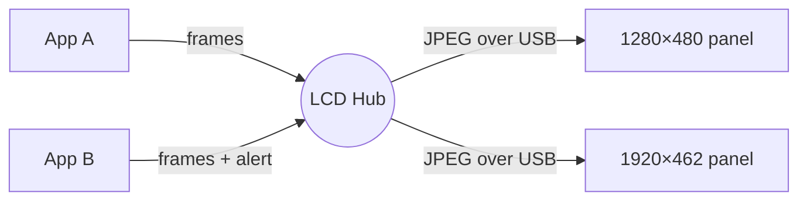
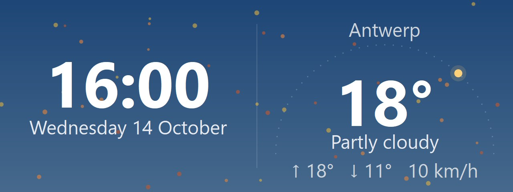
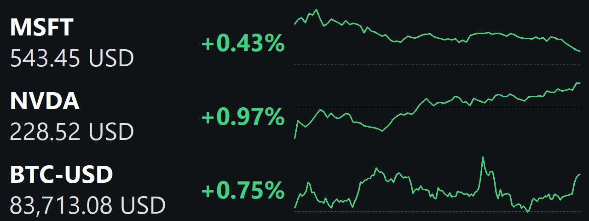
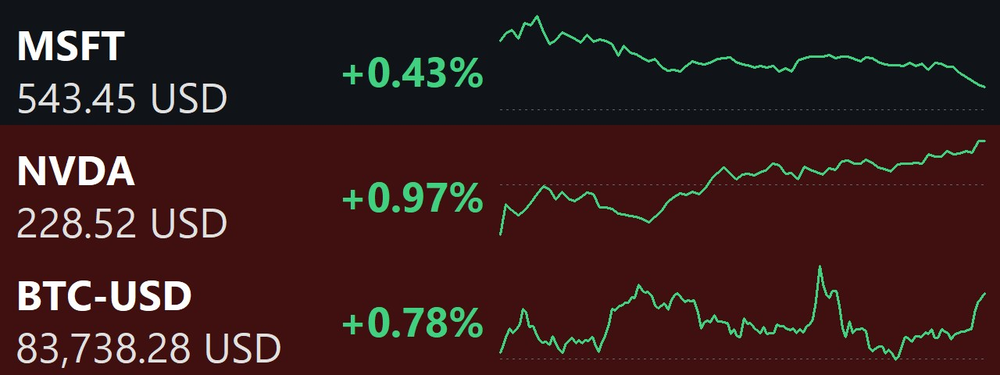

# LCD Hub

**TL;DR:** LCD Hub is a Windows tray app that drives Thermalright's USB LCD panels without
their vendor software. Left alone, a panel shows the maker's logo. With the hub it shows
**Today** instead (time, date and weather), plus whatever your apps send it. Apps take turns on the panel, and an app with
something urgent raises an **alert** to jump the queue.



## Features

- **Drives the panel natively.** It uses plain HID or WinUSB, so no TRCC, no drivers and
  no admin rights are needed. Panels are found when plugged in and dropped when unplugged.
  Each panel keeps its settings across replugs and restarts.
- **Today by default.** When no app has anything to show, the panel shows the time, the date
  and optionally the weather, under a sky that follows the day, with the season's or a
  holiday's touches (and the holiday's name on the day). Today can also take its own turn among the apps.

  
- **Rotation.** Each panel cycles through the apps that sent it a frame, every
  5/10/15/30/60 s, fading from one to the next.
- **One look.** The hub asks every app to draw in the same dark or light style (following
  Windows, or set in the tray) with your accent colour, so the rotation doesn't jump between looks.
- **Alerts.** A frame flagged as an alert pre-empts the rotation, and a video or mirrored
  window as well. Alerting apps share the panel until they send a normal frame again.
- **Toasts.** An app can show a frame over the rotation for a few seconds ("build done"),
  after which the rotation carries on.
- **Video and window mirroring.** Instead of rotating, a panel can play a video file
  (decoded on the GPU, looping) or mirror any open window.
- **Privacy takeover.** While Windows is locked, panels show only Today, whatever the
  apps send. While the monitors sleep, panels go black.
- **Night dimming.** Panels dim to half brightness (or what you choose) through the 40 minutes
  after sunset, and brighten again before sunrise, using the weather's sun times.
- **Per-panel choices.** Each panel can hide any app from its rotation, or keep one app showing
  (alerts still interrupt it).

## Supported devices

| Device | USB id | Size | Wire |
|---|---|---|---|
| Thermalright Trofeo Vision LCD | `0416:5302` | 1280×480 | HID reports |
| Thermalright Trofeo Vision 9.16" | `0416:5408` | 1920×462 | USB bulk (WinUSB) |

Both panels show JPEG frames and drop back to their logo a few seconds after the last one.
The hub therefore resends the current picture every second. The device protocols come from
[thermalright-trcc-linux](https://github.com/Lexonight1/thermalright-trcc-linux).

**Got a similar panel?** Everything device-specific is in
[Panel/LcdPanel.cs](Panel/LcdPanel.cs):
1. Add its USB id and size to `FindDevices`.
2. If it speaks a new protocol, add a `Link` subclass for it. A `Link` wraps a JPEG in the
   panel's framing (`Frame`) and sends it (`Write`).

The protocol notes in thermalright-trcc-linux cover many more models, and [docs/panels.md](docs/panels.md) lists the device-side rules and pitfalls.

## Using it

1. Close TRCC or any other app that drives the panel. Only one process can own a panel.
2. Run `LcdHub.exe`, from the zip on the [releases page](https://github.com/stevehansen/LcdHub/releases)
   or built yourself. A panel icon appears in the tray, and connected panels show Today.
3. Start apps that send frames. They join the rotation by themselves.

### Tray menu

| Item | What it does |
|---|---|
| *panel size* ▸ **Rotate apps** | Back to the rotation, dropping any pinned app, video or mirror |
| *panel size* ▸ *app name* | Show or hide that app on this panel |
| *panel size* ▸ **Keep showing** ▸ *app* | Pin one app on this panel instead of rotating. Alerts still interrupt it |
| *panel size* ▸ **Today** | Give Today its own turn in the rotation |
| *panel size* ▸ **Video file…** | Play a video on this panel instead (remembered) |
| *panel size* ▸ **Mirror window** ▸ | Show a live copy of an open window instead |
| **Today** ▸ | Weather, date, holiday names, sky colours and effects, on or off for every panel |
| **Appearance** ▸ | Follow Windows, dark or light, for every app that supports it |
| **Rotate every** ▸ | How long each app stays on screen, for all apps or per app |
| **Dim at night** ▸ | How bright panels are between dusk and dawn, or off |
| **Preview…** | A window showing what every panel shows right now |
| **Settings** ▸ | Open the settings file, reload it after editing, open the [settings reference](docs/settings.md), or see problems found in it |
| **Start with Windows** | Adds or removes the per-user Run registry entry |

Settings are stored in `%APPDATA%\LcdHub\settings.json`; **Settings ▸ Open settings file** in
the tray opens it with every key filled in, and editors validate it against
[`settings.schema.json`](settings.schema.json), and **Settings ▸ Reload settings** applies your
edits without a restart. A few things are set only there:

- `today.weather_location`: the place for the weather, e.g. `"Antwerp"` (looked up with
  [Open-Meteo](https://open-meteo.com), free and without a key).
- `style.accent`: the accent colour for every app, `"#RRGGBB"` (default: the Windows accent).
- `launch`: apps the hub starts with itself, restarts when they exit and closes when it closes.

```json
{
  "today": { "weather_location": "Antwerp" },
  "launch": [ { "path": "C:\\Tools\\LcdHub\\Stocks.exe", "args": "MSFT NVDA --alert 5" } ]
}
```

Every key is described in [docs/settings.md](docs/settings.md). Problems in the file (a typo,
a bad value, a missing exe) show as ⚠ under **Settings** in the tray.

Running with `--diagnose` logs to
`%TEMP%\lcd-hub.log` and keeps a copy of each panel's current picture at
`%TEMP%\lcd-hub-lcd-<w>x<h>.jpg`.

## Sending frames from your app

Copy [Client/LcdHubClient.cs](Client/LcdHubClient.cs) into a .NET project, or link it with
`<Compile Include="..\LcdHub\Client\LcdHubClient.cs" />`. That single file is the whole
contract.

```csharp
using LcdHub.Client;

var lcd = new LcdHubClient("My App");               // shown in the hub's menu; keep it stable
lcd.PanelsChanged += panels => RedrawAll(panels);   // also on (re)connect: redraw everything
lcd.StyleChanged += _ => RedrawAll(lcd.Panels);     // dark/light or accent changed

void RedrawAll(IReadOnlyList<LcdHubPanel> panels)
{
    foreach (var p in panels)
    {
        // Off screen and not up next: the hub keeps your last frame, so save the work.
        if (lcd.Visibility(p.Id) == LcdHubVisibility.Hidden && !somethingUrgent) continue;
        lcd.Send(p.Id, Render(p.Width, p.Height, lcd.Style), alert: somethingUrgent);
    }
}
```

- A frame is a top-down BGRX `uint[]` of exactly `Width × Height` pixels, drawn at the
  panel's own size. The hub never scales, and it drops frames of the wrong size.
- `Send` never blocks, and only the newest frame per panel is kept. Send whenever your
  picture changes; the hub keeps the panel alive on its own.
- An alert lasts until you send a frame for that panel without `alert`, so send that one
  even while Hidden.
- `lcd.Style` gives the background, text and accent colours to draw with, and whether it's light.
  `lcd.Visibility(id)` is Shown, Next (up next, or no frame from you yet) or Hidden. Both are
  optional: an app that ignores them still works.
- `lcd.Clear(p.Id)` takes your frame off a panel until you send again. It suits an app
  that only has something to say now and then (see the Uptime sample).
- `lcd.Send(id, pixels, validFor: TimeSpan.FromMinutes(2))` lets the hub drop the frame if you
  don't send a newer one in time, so a hung app doesn't leave stale data on screen.
- `lcd.Toast(id, pixels, TimeSpan.FromSeconds(5))` shows a frame over the rotation, a pinned app
  and a video (not over alerts), then the rotation carries on. Stay connected until it's over.
- The client connects and reconnects by itself. Frames sent while the hub isn't running
  are dropped.

From Python, use [clients/python/lcdhub.py](clients/python/lcdhub.py) (standard library only;
[example.py](clients/python/example.py) draws a clock with Pillow and can send a toast:
`python example.py --toast "Build done"`).

Apps in other languages can use the pipe directly. It is a per-user named pipe `\\.\pipe\LcdHub`
carrying small length-prefixed messages, documented on `LcdHubWire` in the same file.

## Samples

Small, complete producers live in [samples/](samples/). Each is one `Program.cs` on top of a
shared [`Canvas`](samples/Common/Canvas.cs) (GDI text, boxes and lines) and a
fetch-draw-send loop ([`Sample.Run`](samples/Common/Sample.cs)):

| Sample | Shows | Needs |
|---|---|---|
| [Stocks](samples/Stocks/Program.cs) | Price, day change and intraday chart per ticker. `--alert 5` takes over the panel on a 5% move | nothing |
| [Uptime](samples/Uptime/Program.cs) | Only the [Phare](https://phare.io) monitors that are down, as an alert. Nothing at all while everything is up | `PHARE_API_KEY` |

| Stocks | Stocks, `--alert 0.5` |
|---|---|
|  |  |

*On a 1280×480 panel.*

To keep a sample running without a console, build it and add its exe to `launch` (see above).

```powershell
dotnet run --project samples\Stocks -- MSFT NVDA BTC-USD --alert 5
$env:PHARE_API_KEY = "..."; dotnet run --project samples\Uptime
```

## How it works

- **One owner.** The hub is the only process that touches the USB panels. Apps never see
  the devices, only the panel ids and sizes the hub announces.
- **Apps draw, the hub schedules.** Each app's newest frame per panel is kept. Every second,
  and whenever a frame arrives, the hub decides what each panel shows. In priority order:
  1. Monitors off → black.
  2. Locked → Today.
  3. Any alert → rotate among the alerting apps.
  4. Any toast → that, until it runs out.
  5. An app you chose to keep showing → that app.
  6. A video or window → that.
  7. Otherwise → rotate among the apps (plus Today, or only Today if there are none).

  These rules are one pure function, [Rotation.cs](Rotation.cs), which is covered by the
  tests.
- **Panels.** Each panel has its own sender thread. It JPEG-encodes the current picture
  (lower quality for video so it keeps up), turns it upside down where the panel is mounted
  that way, and resends it every second.

## Build

Requires the .NET 10 SDK on Windows. The app is pure Win32 through P/Invoke, with no
WinForms or WPF.

```powershell
dotnet build
dotnet run --project .\LcdHub.csproj -- --diagnose
dotnet run --project .\Tests\LcdHub.Tests.csproj   # rotation rules + wire format
.\publish-aot.bat                                  # native AOT exe in bin\Publish\AOT
```

Pushing a tag such as `v0.1.0` runs [the release workflow](.github/workflows/release.yml): it
runs the tests, builds the native exe and the samples, and publishes a GitHub release with both
zips. A tag with a suffix (`v0.2.0-beta`) makes a pre-release. The exes are signed with Azure
Artifact Signing when the repo's `release` environment has the signing variables; a fork without
them still gets unsigned releases.

## License

[MIT](LICENSE)
